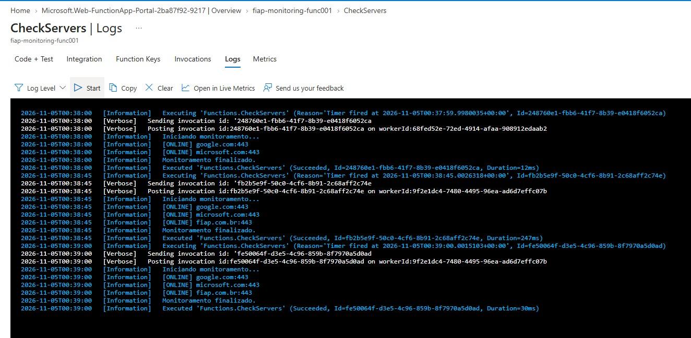
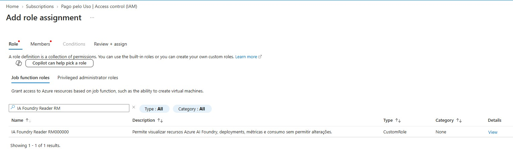

# GS-S2-2026-Cloud
Prova GS2 para a turma 2TDCR-2026

Obs: Após o termino da prova, os arquivos de configuração e 'gabaritos' serão atualizados neste repositório. 

# Q1 Functions
5 pontos. Será validado o desenvolvimento do aluno, não apenas a resposta final

A FIAP Tech está desenvolvendo um serviço para integrar os campi da Paulista e da Lins.

Alguns sistemas precisam ser monitorados constantemente e alertados quando estiverem Offline.
Neste momento, vcs foram solicitados para criar um mecanismos de validação online, utilizando os serviços de nuvem, mais especificamente o Azure Functions.
Sua tarefa é criar uma Function acionada automaticamente a cada espaço de segundos para verificar se um servidor está online.

Requisitos:
- A Function deve ter o nome exato de Function_RMRM<o número do seu RM>. Variações desta nomenclatura serão penalizadas. 
- A Function deve utilizar um Timer Trigger.
- A execução deve ocorrer entre 15 ou 30 segundos (para não ficar esperando muito).
- O endereço IP ou hostname do servidor será fornecido através de uma variável de ambiente. Para testes, use google.com:443, microsoft.com:443, www2.fiap.com.br:443, fiap-com-br.mail.protection.outlook.com:587 e fiap.com.br:443. Caso decida colocar no seu próprio código, fique à vontade. 
- A Function deve registrar em log se o servidor está ONLINE ou OFFLINE.
- Após implementar a função, publique-a em uma Azure Function App previamente criada.


<i> Use a Function existente na Azure (fiap-monitoring-func001), no Resource Group RG-FIAP-GS1</i>


Entregáveis:

Sua Function deve ser executada em: 
```
Function App (fiap-monitoring-func001)
├── Function_RM<xyz>
	├── Logs
``` 





# Q2 RBAC
5 pontos. Será validado as permissões incluídas até o total de 5 pontos (todas as permissões). Mas atenção, não são APENAS 5 permissões necessárias...

A FIAP está utilizando o Azure AI Foundry para desenvolver soluções baseadas em Inteligência Artificial Generativa.
Um analista solicitou a função Global Administrator alegando que precisa verificar os projetos existentes, os modelos implantados e o consumo gerado pelos serviços de IA.
Como Analista de Segurança, você identificou que a permissão solicitada é excessiva e viola o princípio do menor privilégio (Least Privilege).
Você foi incumbido de criar uma Custom Role (RBAC) que permita ao analista executar apenas as atividades necessárias.

Requisitos:

Após uma conversa para entender a real necessidade do analista, vc entendeu que as principais funções a serem desempenhadas são: 

- Visualizar os recursos do Azure AI Foundry.
- Visualizar os deployments (implantações) de modelos.
- Visualizar os modelos disponíveis nos recursos de IA.
- Visualizar métricas operacionais dos recursos.
- Visualizar informações de consumo e custos.
- Visualizar Resource Groups e recursos associados.

A Role não deve permitir que o analista:

- Crie recursos.
- Altere recursos.
- Exclua recursos.
- Crie deployments de modelos.
- Exclua deployments de modelos.
- Altere permissões RBAC ou IAM.
- Conceda acesso a outros usuários.

Tarefas: 
Criar uma Custom Role chamada:
1. IA Foundry Reader RM<o número do seu RM>. Variações desta nomenclatura serão penalizadas. 
2. Definir as permissões necessárias para atender aos requisitos apresentados.
3. Atribuir a Role no menor escopo possível.
4. Use a Subscription "Pago pelo Uso" (ID: <b>9e2cc55a-0be2-431f-9cb7-0b7e3a8eab7a</b>) para a criação da role solicitada

Entregáveis:

Para a correção, a role será validada dentro da própria Subscription. 

